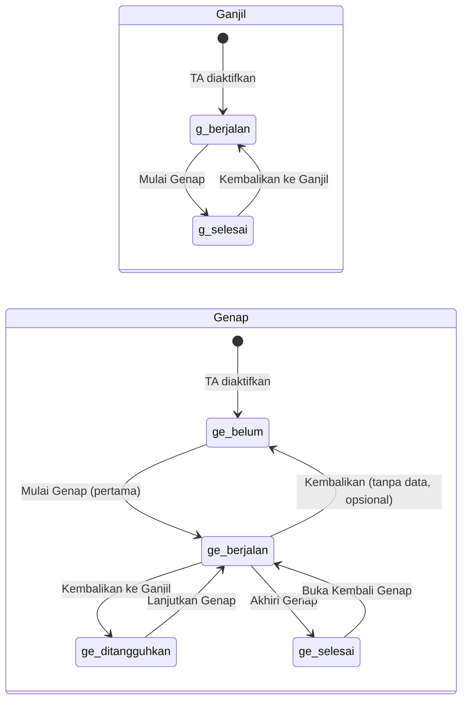

# Modul 05: Kembalikan ke Semester Ganjil (Tanpa Hapus Data Genap)

## Tujuan

Admin cabang dapat **mengembalikan konteks aktif ke semester ganjil** meskipun semester genap sudah memiliki data akademik. Data genap **tetap tersimpan** di database dan dapat dilanjutkan kembali nanti.

## Latar Belakang Masalah

### Perilaku saat ini

Aksi **Batalkan Genap** (`TahunAjaranService::kembalikanKeSemesterGanjil`) diblokir jika `memilikiDataSemester($genap)` mengembalikan `true`:

```php
// app/Services/TahunAjaranService.php (baris 204–208)
if ($this->memilikiDataSemester($genap)) {
    throw ValidationException::withMessages([
        'semester' => 'Semester genap sudah memiliki data akademik dan tidak dapat dibatalkan.',
    ]);
}
```

Jika rollback berhasil (tanpa data), semester genap di-reset ke `belum_dimulai` dan `tanggal_mulai` di-null-kan — seolah semester genap belum pernah dimulai.

### Kendala desain

| Masalah | Dampak |
|---------|--------|
| Cek data memblokir rollback | Admin tidak bisa koreksi input ganjil setelah genap sudah berjalan |
| Genap → `belum_dimulai` saat rollback | Status tidak mencerminkan kenyataan jika nanti rollback diizinkan dengan data |
| `memilikiDataSemester()` mencakup data level TA | `rombel_siswa`, `penugasan_mengajar`, `penugasan_pembina` di-scope `tahun_ajaran_id`, bukan `semester_id` — bisa memblokir rollback meski data bukan milik genap |
| `bukaKembaliSemesterGenap()` juga diblokir jika ada data | Alur lanjutkan genap setelah diakhiri tidak konsisten dengan kebutuhan baru |

### Data akademik per scope

**Per semester** (`semester_id`):

- `nilai_tujuan_pembelajaran`
- `nilai_ujian`
- `pencapaian_tp`
- `absensi_siswa`
- `catatan_wali_kelas`

**Per tahun ajaran** (`tahun_ajaran_id`, dipakai kedua semester):

- `rombel_siswa`
- `penugasan_mengajar`
- `penugasan_pembina`
- `kelas`, `tujuan_pembelajaran` (via penugasan)

Modul guru menulis data nilai/absensi/catatan hanya ke **semester berjalan** (`semesterBerjalan` relation). Isolasi data ganjil vs genap sudah dijamin oleh `semester_id` selama konteks aktif benar.

---

## Solusi yang Diusulkan

### Prinsip

1. **Satu semester berjalan** pada satu waktu (invariant tetap dipertahankan).
2. Rollback **tidak menghapus** baris data genap.
3. Status semester genap setelah rollback **tidak** kembali ke `belum_dimulai` jika sudah pernah berjalan / punya data.
4. Admin dapat **melanjutkan genap** dari status ditangguhkan tanpa kehilangan data.

### Status semester baru: `ditangguhkan`

Tambahkan nilai enum `StatusSemester::Ditangguhkan` untuk semester yang pernah berjalan, memiliki data (atau sudah dimulai), lalu dikembalikan ke ganjil.

| Status | Makna |
|--------|-------|
| `belum_dimulai` | Belum pernah dimulai |
| `berjalan` | Konteks aktif — input data diizinkan |
| `ditangguhkan` | Pernah berjalan, data tersimpan, sementara tidak aktif |
| `selesai` | Semester resmi diakhiri |

### Mesin status (state machine)



**Catatan:** Rollback tanpa data genap boleh tetap mengembalikan genap ke `belum_dimulai` (perilaku lama) untuk menjaga kesederhanaan UI.

---

## Perubahan Backend

### 1. Enum & migrasi

| File | Perubahan |
|------|-----------|
| `app/Enums/StatusSemester.php` | Tambah case `Ditangguhkan = 'ditangguhkan'` + label |
| `database/migrations/...` | Tidak wajib alter kolom (string enum), cukup dokumentasi nilai baru |

### 2. `TahunAjaranService`

#### `kembalikanKeSemesterGanjil()`

- **Hapus** blok `memilikiDataSemester($genap)`.
- Prekondisi tetap: TA aktif, ganjil `selesai`, genap `berjalan`.
- Transaksi:
  - Ganjil → `berjalan`, `tanggal_selesai = null`
  - Genap:
    - Jika `memilikiDataSemesterGenap($genap)` → `ditangguhkan` (pertahankan `tanggal_mulai`)
    - Jika tidak ada data semester genap → `belum_dimulai`, `tanggal_mulai = null` (perilaku lama)
- Log: tetap `AksiLogAkademik::DikembalikanKeGanjil`, tambahkan keterangan jika genap ditangguhkan.

#### `pindahKeSemesterGenap()` — perluas

Saat ini genap harus `belum_dimulai`. Perluas agar juga menerima genap `ditangguhkan` (**Lanjutkan Genap**):

- Ganjil `berjalan` → `selesai`, set `tanggal_selesai`
- Genap `ditangguhkan` → `berjalan` (pertahankan `tanggal_mulai` asli)
- Log: gunakan `SemesterGenapDimulai` atau tambah `SemesterGenapDilanjutkan` (opsional, untuk audit lebih jelas)

#### `bukaKembaliSemesterGenap()`

- **Hapus** blok `memilikiDataSemester($genap)`.
- Genap `selesai` → `berjalan`, null-kan `tanggal_selesai`.
- Data genap tetap utuh.

#### `memilikiDataSemester()` → refactor

Pisahkan menjadi dua method:

```php
memilikiDataTahunAjaran(TahunAjaran $ta): bool  // rombel, penugasan — level TA
memilikiDataSemesterGenap(Semester $genap): bool // hanya tabel ber-semester_id
```

`memilikiDataSemesterGenap` dipakai untuk memutuskan status `ditangguhkan` vs `belum_dimulai` saat rollback, **bukan** untuk memblokir aksi.

#### `tutup()` — tanpa perubahan logika

Tetap mensyaratkan genap `selesai`. Jika genap `ditangguhkan` atau ganjil `berjalan`, TA tidak bisa ditutup (sudah aman).

### 3. Model `TahunAjaran`

- Helper opsional: `semesterDitangguhkan(): ?Semester` atau cek via `semesterGenap()?->status === Ditangguhkan`.
- `semesterBerjalan()` relation tetap `where status = berjalan` — tidak perlu diubah.

### 4. Controller & route

| Route | Perubahan |
|-------|-----------|
| `POST .../kembalikan-ganjil` | Tidak ada route baru |
| `POST .../pindah-genap` | Tangani genap `belum_dimulai` dan `ditangguhkan` |
| `POST .../buka-kembali-genap` | Izinkan meski ada data |

Controller `TahunAjaranController` — pesan sukses/gagal disesuaikan.

---

## Perubahan UI

### Halaman `admin-cabang/data-akademik/tahun-ajaran/index.blade.php`

| Kondisi | Tombol | Pesan konfirmasi (baru) |
|---------|--------|-------------------------|
| Ganjil `berjalan`, genap `belum_dimulai` | **Mulai Genap** | (tetap) |
| Ganjil `berjalan`, genap `ditangguhkan` | **Lanjutkan Genap** | "Semester ganjil akan ditutup dan semester genap dilanjutkan. Data genap yang sudah ada tetap tersimpan." |
| Genap `berjalan` | **Batalkan Genap** | "Konteks akan kembali ke semester ganjil. Data semester genap **tidak dihapus** dan dapat dilanjutkan nanti." |
| Genap `selesai` | **Buka Genap** | Hapus batasan "belum ada data" dari teks |

### Badge status semester di tabel

Tampilkan label `Ditangguhkan` dengan warna berbeda (mis. violet/amber) agar admin paham genap punya data tertunda.

### Konteks akademik (header admin & guru)

`partials/*/konteks-akademik.blade.php` — tidak perlu diubah; otomatis menampilkan semester `berjalan` (ganjil setelah rollback).

---

## Dampak Modul Guru (read-only saat rollback)

Saat konteks = ganjil `berjalan`:

| Modul | Perilaku |
|-------|----------|
| Input nilai TP / ujian | Menulis ke `semester_id` ganjil |
| Absensi & catatan wali kelas | Menulis ke `semester_id` ganjil |
| Leger & cetak raport | Menampilkan data semester ganjil |
| Data genap | Tetap ada di DB, **tidak tampil** di input aktif, bisa diakses kembali saat genap dilanjutkan |

**Tidak perlu** mengubah controller guru selama mereka selalu memakai `semesterBerjalan()`.

### Edge case: edit data ganjil setelah genap sempat diisi

- Nilai ganjil yang diedit setelah rollback **tidak** mempengaruhi data genap (beda `semester_id`).
- Jika admin melanjutkan genap, data genap lama tetap ada; guru melanjutkan input genap.

---

## Testing

### File: `tests/Feature/AdminCabang/TahunAjaranTest.php`

| Test case | Ekspektasi |
|-----------|------------|
| `kembalikan_ke_ganjil_tanpa_data` | Genap → `belum_dimulai`, ganjil → `berjalan` (regresi) |
| `kembalikan_ke_ganjil_dengan_nilai_tp_genap` | Sukses; genap → `ditangguhkan`; baris nilai TP genap masih ada |
| `kembalikan_ke_ganjil_dengan_absensi_genap` | Sukses; data absensi tidak terhapus |
| `lanjutkan_genap_setelah_ditangguhkan` | Ganjil → `selesai`, genap → `berjalan`; data genap masih ada |
| `buka_kembali_genap_dengan_data` | Sukses meski ada nilai ujian genap |
| `tutup_ta_gagal_saat_genap_ditangguhkan` | TA tidak bisa ditutup |
| `input_nilai_ganjil_setelah_rollback` | Guru bisa simpan nilai ke semester ganjil |

### Factory / setup

Gunakan factory `NilaiTujuanPembelajaran`, `AbsensiSiswa`, dll. dengan `semester_id` genap.

---

## File Deliverables

| File | Aksi |
|------|------|
| `app/Enums/StatusSemester.php` | Tambah `Ditangguhkan` |
| `app/Services/TahunAjaranService.php` | Refactor rollback, lanjutkan genap, hapus blok data |
| `app/Http/Controllers/AdminCabang/TahunAjaranController.php` | Sesuaikan pesan flash |
| `resources/views/admin-cabang/data-akademik/tahun-ajaran/index.blade.php` | Tombol & teks konfirmasi |
| `resources/js/modal.js` | Label status `ditangguhkan` di `statusSemesterLabels` (jika dipakai di modal detail TA) |
| `tests/Feature/AdminCabang/TahunAjaranTest.php` | Test case baru |
| `database/factories/TahunAjaranFactory.php` | State factory `genapDitangguhkan()` (opsional) |

**Tidak perlu:** migrasi schema baru, perubahan tabel nilai, perubahan route baru.

---

## Urutan Implementasi

1. Tambah enum `Ditangguhkan` + label JS/UI
2. Refactor `memilikiDataSemester` → `memilikiDataSemesterGenap`
3. Ubah `kembalikanKeSemesterGanjil` (hapus blok, set status ditangguhkan)
4. Perluas `pindahKeSemesterGenap` untuk genap `ditangguhkan`
5. Ubah `bukaKembaliSemesterGenap` (hapus blok data)
6. Update view tombol & pesan konfirmasi
7. Tulis & jalankan test

---

## Risiko & Mitigasi

| Risiko | Mitigasi |
|--------|----------|
| Admin bingung dengan status `Ditangguhkan` | Badge jelas + pesan konfirmasi eksplisit |
| Dua semester punya data overlapping waktu | Normal di sistem raport; isolasi via `semester_id` |
| `tutup()` dipanggil saat ganjil masih berjalan | Prekondisi existing sudah mencegah (genap harus `selesai`) |
| Audit log kurang detail | Opsional: enum log `SemesterGenapDilanjutkan` |

---

## Di Luar Scope (opsional / fase berikutnya)

- Halaman **arsip baca-only** untuk melihat data genap saat konteks ganjil aktif
- Notifikasi ke guru saat konteks berubah
- Export raport genap tanpa melanjutkan semester
